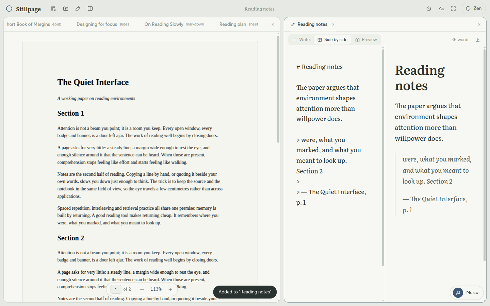
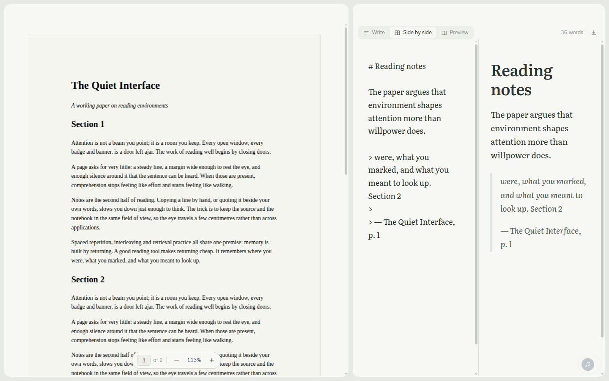
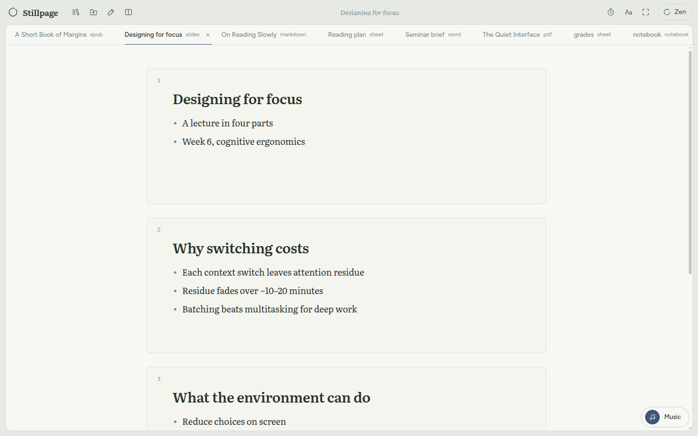
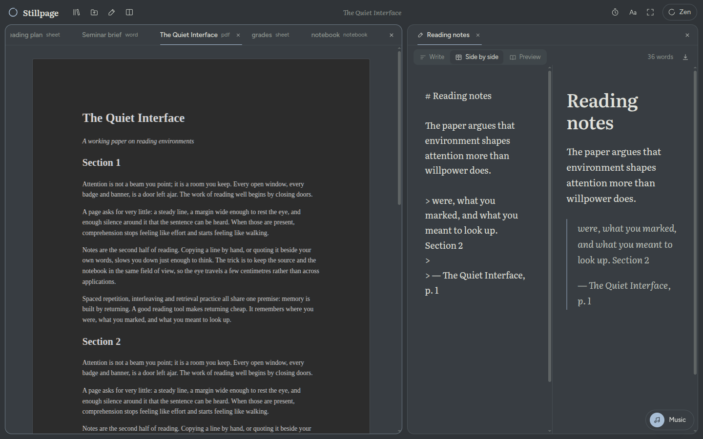
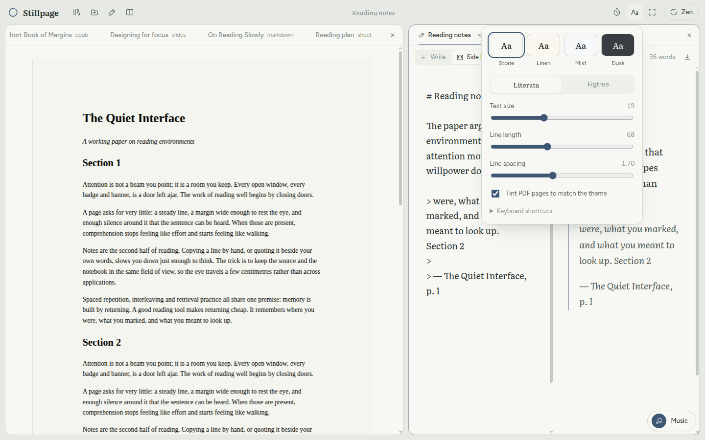

<p align="center">
  
</p>

<h1 align="center">Stillpage</h1>

<p align="center">
  A calm desktop reader and notebook for Linux.<br>
  Open a PDF, a Word file, a deck or a folder of notes, write beside it, and keep your music playing. All in one window.
</p>

<p align="center">
  
</p>

## Why

Studying usually means one app for the PDF, another for notes, a browser tab for music, and a lot of alt-tabbing. Stillpage puts all of that in one quiet window. Stretch it across two monitors, split it into panes, and drag tabs wherever you need them. You never leave the page.

## What it does

- **Reads almost anything**: PDF, Word, PowerPoint and Excel, LibreOffice documents, presentations and spreadsheets (`.odt`, `.odp`, `.ods`, and the flat `.fodt`/`.fodp`/`.fods`), CSV and TSV, EPUB, Markdown, Jupyter notebooks, RTF, HTML, plain text, images, and source code in about 50 languages. Headings, lists, footnotes, tables, links and speaker notes all come through.
- **Reading view or the original pages**: Word, PowerPoint and LibreOffice files open reflowed in your theme and text size. One click on **Original** shows the pages exactly as the author laid them out, and you can still select and quote from them. If [LibreOffice](https://www.libreoffice.org) is installed, Stillpage also opens old `.doc` and `.ppt` files, drawings (`.odg`), Visio, Publisher, WordPerfect, Pages and Keynote files the same way. Without it, those files tell you the one command that installs it.
- **Your folders, as they are**: open any folder of notes and documents (**Open a folder** in the library, `Ctrl Shift O`, drop a folder on the window, or `stillpage ~/notes`). Everything Stillpage can read appears as a tree that follows the disk, and nothing has to be added by hand. New notes you make there are plain `.md` files, so the folder stays yours to sync with Git or Syncthing. Rename files, move them to the trash, and press `Ctrl P` to jump to any note or file by typing a few letters.
- **Edit files in place**: Markdown, text, HTML and source files have **Read** and **Edit** modes. Edits save straight back to the file as you type, and Stillpage asks before overwriting a file that another program has changed. Markdown is written like a page, with tables and formulas, or edited as **Source**. Code opens in a quiet editor with syntax colours.
- **Two screens, one window**: `Ctrl Shift S` turns Stillpage into one full-screen window across every monitor, with the pane divider on the bezel. Press it again to go back.
- **Split panes with tabs**: up to four side-by-side panes, each with its own tabs. Drag tabs between panes and drop files from your file manager straight into a pane. Drag a divider and each pane's text and PDF zoom adjust to its new width.
- **Notes beside the source**: write the way you read. Type `# ` for a heading, `- ` for a list, `[ ] ` for a checklist or `**bold**`, and it turns into the real thing with no symbols left behind. Select text for a small formatting bar. Notes save as you type (as Markdown underneath) and export to PDF or Markdown. A new note is only kept once you write in it or name it; double-click a note's tab to rename it. Select a passage in any document and choose **Add to note** to quote it, page number included.
- **Formulas**: press `Ctrl M` in a note for an inline formula, or `Ctrl Shift M` for one on its own line. The formula editor shows a live preview and offers command completion, a symbol palette (fractions, integrals, matrices, Greek, arrows and more) and blanks you fill in with `Tab`. Click a formula to edit it. Markdown files and Jupyter notebooks render `$…$` and `$$…$$` too, and formulas survive PDF export.
- **Dictionaries, offline**: right-click a word, press `Ctrl D`, or choose **Define** on a selection. English (WordNet) gives definitions, examples and synonyms; in a note, click a synonym to put it in place of the word. Japanese (JMdict) finds the dictionary form of what you point at, so 食べさせられた looks up 食べる.
- **Spelling and autocorrect**: right-click a misspelled word for suggestions or to add it to the dictionary. Common typos are fixed as you write ("teh" → the, "dont" → don't); press `Backspace` straight after a fix to undo it. Autocorrect can be turned off in reading settings.
- **Zen mode** (`Ctrl .`): the chrome fades away and only the text remains. Move the pointer to the top edge to get the toolbar back.
- **Typography you control**: Literata or Figtree, text size, line length and spacing. Four themes: Stone, Linen, Mist and Dusk, a soft dim theme that is not pitch black. PDF pages can take on the theme's paper tone.
- **Spotify built in**: paste a playlist link into the small pill in the corner and it plays inside the app. With Premium you can also connect Spotify and control it on your phone or desktop.
- **Focus timer**: 15, 25, 50 or 90 minutes, ending with a soft chime.
- **Private by design**: everything stays on your computer. No accounts, no telemetry. The only network calls go to Spotify, and only if you connect it.

<table>
  <tr>
    <td></td>
    <td></td>
  </tr>
  <tr>
    <td></td>
    <td></td>
  </tr>
</table>

## Install

Download the latest `.deb` or `.AppImage` from [Releases](https://github.com/sujayrittikar/stillpage/releases/latest).

**Ubuntu, Debian, Mint, Pop!_OS** (recommended). From the folder you downloaded it to:

```bash
sudo apt install ./Stillpage-*-amd64.deb
```

Stillpage then shows up in your app launcher, and "Open with Stillpage" appears in your file manager for PDFs, Office files, EPUBs and Markdown.

**Arch, Manjaro, EndeavourOS**: build it from this repository with `makepkg`, which is how the AUR works too. It downloads the release, checks its checksum and installs it as a normal package:

```bash
git clone https://github.com/sujayrittikar/stillpage.git
cd stillpage/packaging/aur
makepkg -si
```

To update later, run `git pull && makepkg -si` in the same folder.

Or install the ready-made package: download `stillpage-bin-*-x86_64.pkg.tar.zst` and `SHA256SUMS` from the [latest release](https://github.com/sujayrittikar/stillpage/releases/latest), then

```bash
sha256sum -c SHA256SUMS --ignore-missing
sudo pacman -U ./stillpage-bin-*-x86_64.pkg.tar.zst
```

For the original page layout and older Office formats, also install LibreOffice: `sudo pacman -S libreoffice-fresh`. An AUR package, `stillpage-bin`, will follow once AUR registration reopens.

**Any other distro**: use the AppImage.

```bash
chmod +x Stillpage-*-x86_64.AppImage
./Stillpage-*-x86_64.AppImage
```

> On Ubuntu 24.04 and newer, AppArmor blocks the Chromium sandbox for AppImages. If the AppImage exits straight away, run it with `--no-sandbox`, or use the `.deb`, which installs the right AppArmor profile for you.

## Music

The quickest way needs no setup:

1. In Spotify, open a playlist and choose **Share → Copy link to playlist**.
2. In Stillpage, open the music pill (bottom right), paste the link and choose **Play**.
3. Choose **Sign in for full songs** once. Until you do, Spotify plays 30-second previews.

### Controlling Spotify with Premium (optional)

To see what's playing, pick from your playlists and control Spotify on your phone or desktop, connect a Spotify developer app. Spotify requires every app to have its own Client ID. It takes about two minutes:

1. Open the [Spotify developer dashboard](https://developer.spotify.com/dashboard) and create an app.
2. Add the redirect URI `http://127.0.0.1:43117/callback`.
3. Tick **Web API** and **Web Playback SDK**.
4. In Stillpage, open the music pill, expand **Control Spotify with Premium**, paste the Client ID and choose **Connect**.

Good to know:

- Spotify only allows playback control for **Premium** accounts. Pasted links work on any account.
- New Spotify apps start in development mode, which is limited to the accounts you add under *User Management* in the dashboard.
- Stillpage uses the PKCE flow, so there is no client secret. Tokens are stored locally and nowhere else.
- Release builds use [castlabs Electron](https://github.com/castlabs/electron-releases), which includes the Widevine module Spotify needs to stream audio. If Widevine is unavailable, Stillpage falls back to controlling another Spotify device.

## Keyboard

| Keys | Action |
| --- | --- |
| `Ctrl O` | Open files |
| `Ctrl Shift O` | Open a folder |
| `Ctrl P` | Find any note, document or file in the folder |
| `Alt N` | New note beside the current document |
| `Ctrl \` | Split the workspace |
| `Ctrl .` | Zen mode (`Esc` to leave) |
| `Ctrl +`, `Ctrl -`, `Ctrl 0` | Bigger, smaller, default text. In a PDF, zoom. `Ctrl` + scroll works too |
| `Ctrl Shift S` | Span all screens, or go back to one |
| `F11` | Full screen |
| `Alt W` | Close tab |
| `Ctrl Tab` | Next tab in the pane |
| `Alt 1`–`4` | Jump to a pane |
| `Ctrl B`, `Ctrl I`, `Ctrl U` | Bold, italic, underline in notes |
| `Ctrl M`, `Ctrl Shift M` | Inline formula, formula on its own line |
| `Ctrl D` | Look up the word at the cursor or selection |
| `F2` | Rename a file in the folder tree |
| `Ctrl` + scroll | Zoom a PDF |

## Develop

You need Node.js 20 or newer.

```bash
git clone https://github.com/sujayrittikar/stillpage.git
cd stillpage
npm install
npm run dev        # Vite + Electron with hot reload
npm run dist       # builds release/*.deb and release/*.AppImage
```

`npm run dev` and `npm run build` first build the dictionaries into `public/dict` (`scripts/build-dictionary.mjs`). The English one comes from an npm package. The Japanese dictionary and the autocorrect list are downloaded once from pinned, checksummed addresses and cached in `node_modules/.cache`. Without a network connection the build still works, just without those two.

The project layout:

```
electron/          main process: window, app:// protocol, "Open with", file saving, folder watching, Spotify login
src/lib/parse/     one small parser per format, loaded on demand
src/lib/render.ts  picks a parser and caches the result so panes share it
src/lib/           library, folders (vault.ts), formulas, dictionaries, autocorrect
src/components/    panes, viewers, note and file editors, dictionary card, music dock
scripts/           build helpers, including the dictionary builder
```

Every document is parsed in the renderer and sanitised with DOMPurify before display. Documents never get to run scripts or bring their own styles, so everything reads in Stillpage's typography.

## Roadmap

- Highlights and annotations stored per document
- Full-text search across the library and the open folder
- Links between notes (`[[wiki links]]`) and backlinks
- Flatpak and `.rpm` builds
- `stillpage-bin` on the AUR, once registration reopens

Contributions are welcome. See [CONTRIBUTING.md](CONTRIBUTING.md).

## License

[MIT](LICENSE). Stillpage is not affiliated with Spotify.

The built-in English dictionary is [WordNet 3.0](https://wordnet.princeton.edu/), © 2006 Princeton University, used under the WordNet licence, which ships with the app. The Japanese dictionary is [JMdict](https://www.edrdg.org/jmdict/j_jmdict.html) (common entries, via [jmdict-simplified](https://github.com/scriptin/jmdict-simplified)), the property of the Electronic Dictionary Research and Development Group, and the autocorrect list comes from [cspell's common English misspellings](https://github.com/streetsidesoftware/cspell-dicts); both are used under CC BY-SA 4.0, and their notices ship with the app.
